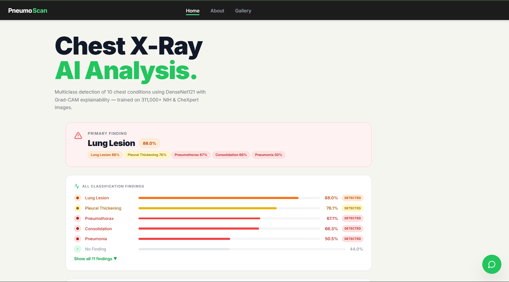
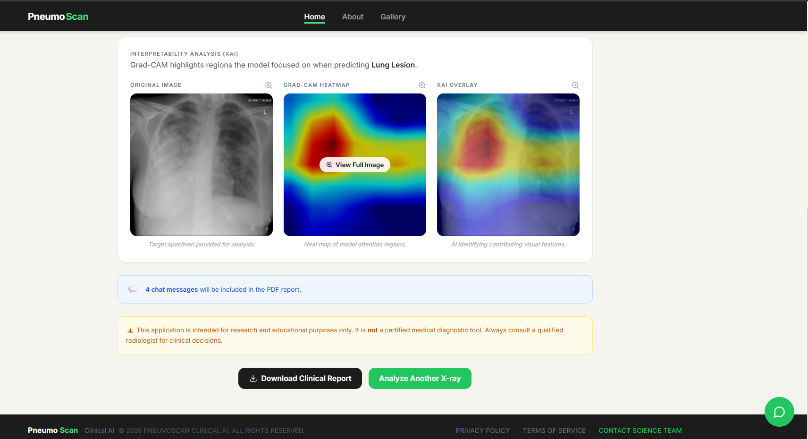
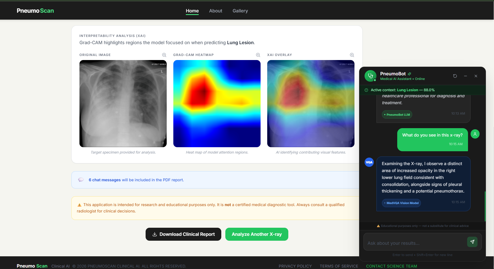
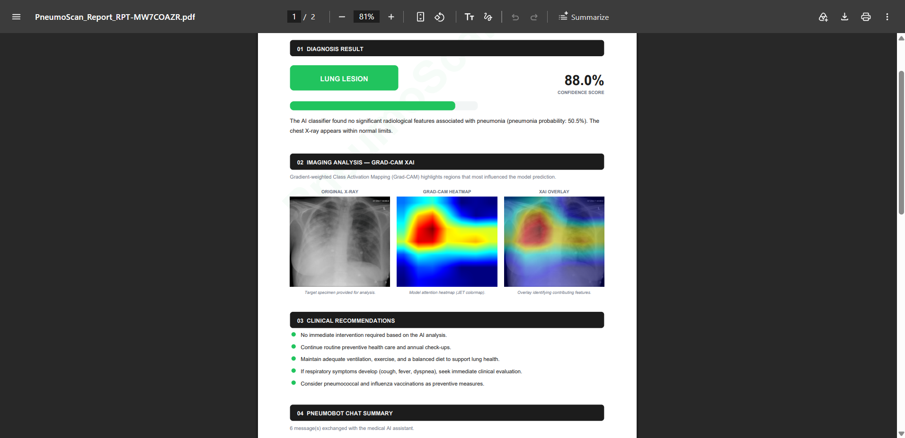
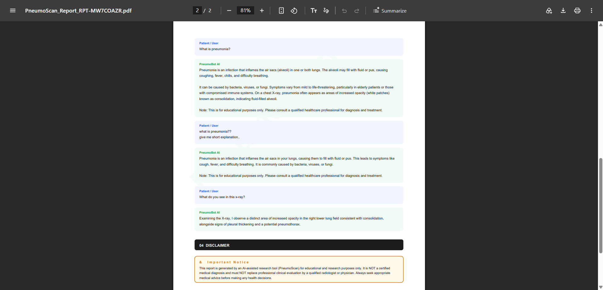
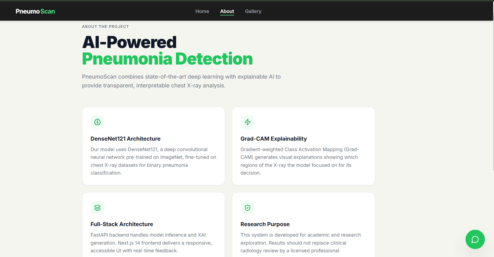
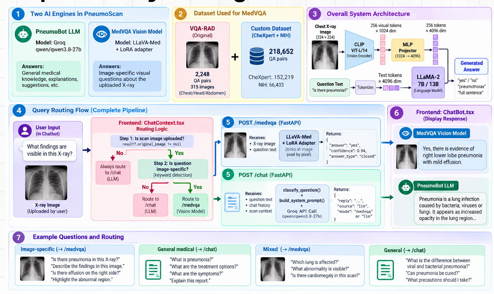

# PneumoScan — AI-Powered Chest X-Ray Disease Detection with Explainability

PneumoScan is a full-stack AI radiology assistant that detects **11 thoracic conditions** from chest X-rays using a **DenseNet121** deep learning model, explains every prediction with **Grad-CAM** visual heatmaps, and provides an **AI chat assistant (PneumoBot)** powered by Groq LLM for follow-up medical queries — plus a **Medical Visual Question Answering (MedVQA)** module fine-tuned with LoRA on LLaVA-Med.

It combines **PyTorch**, **FastAPI**, **Groq LLM**, **LLaVA-Med + LoRA**, and a **Next.js 14** frontend to deliver transparent, interpretable chest X-ray analysis with clinical-grade PDF reporting.

<p align="center">
  <a href="#-the-problem">Problem</a> ·
  <a href="#-the-solution">Solution</a> ·
  <a href="#-key-features">Features</a> ·
  <a href="#-demo">Demo</a> ·
  <a href="#-complete-end-to-end-architecture">Architecture</a> ·
  <a href="#-explainable-ai--grad-cam">Grad-CAM XAI</a> ·
  <a href="#-medical-visual-question-answering-medvqa">MedVQA</a> ·
  <a href="#-dual-mode-query-routing">Query Routing</a> ·
  <a href="#-project-structure">Project Structure</a> ·
  <a href="#-local-setup--development">Setup</a> ·
  <a href="#-api-endpoints">API</a> ·
  <a href="#-license--disclaimer">License</a>
</p>

---

## 🚧 The Problem

Chest X-rays are the most common diagnostic imaging modality in radiology, but interpreting them requires specialised expertise that isn't always available — especially in underserved regions. The key challenges:

- **11 overlapping thoracic conditions** — pneumonia, atelectasis, cardiomegaly, pleural effusion, consolidation, pulmonary edema, pneumothorax, infiltration, lung lesions, pleural thickening, and "no finding" — can co-occur in a single X-ray, making multi-label classification essential.

- **Black-box predictions** — deep learning models can achieve high accuracy, but if clinicians can't see *why* a model predicted a disease, they can't trust or validate the output. A 94% pneumonia score is meaningless without knowing which lung region drove the decision.

- **No follow-up guidance** — after a prediction, patients and clinicians often have questions: *"What does this finding mean?"*, *"Which lung is more affected?"*, *"What should I do next?"* — and a static web app can't answer those.

---

## 💡 The Solution

PneumoScan addresses all three problems in a single integrated platform:

1. **Multi-disease detection** — A DenseNet121 model (fine-tuned on 311,000+ NIH ChestX-ray14 images) uses independent sigmoid outputs for each of 11 classes, so multiple conditions can be flagged simultaneously — not just a binary "pneumonia / normal" verdict.

2. **Explainable AI (XAI)** — After each prediction, **Grad-CAM** generates a visual heatmap highlighting the exact image regions that most influenced the model's decision. The original X-ray, raw heatmap, and blended overlay are all returned and displayed side-by-side, so a radiologist can visually verify the model's reasoning.

3. **AI chat assistant (PneumoBot)** — A floating chatbot powered by **Groq's LLM** answers follow-up questions about the scan. It automatically classifies whether a question is *image-specific* (e.g. *"Which lung is more affected?"*) or *general medical knowledge* (e.g. *"What causes pneumonia?"*) and switches between a vision-model persona and a knowledge-expert persona accordingly.

4. **Medical Visual Question Answering (MedVQA)** — For true image-grounded questions, an optional **LLaVA-Med + LoRA** module (fine-tuned on 315 VQA-RAD chest X-ray QA pairs) directly analyses the uploaded image to produce clinically relevant answers.

5. **Clinical PDF reports** — One click generates a branded, multi-section PDF with diagnosis results, Grad-CAM XAI images, clinical recommendations, and a transcript of the PneumoBot conversation.

---

## ✨ Key Features

- 🫁 **Multi-disease detection** — DenseNet121 classifies 11 thoracic conditions simultaneously using independent sigmoid heads; each finding shows probability % and a "DETECTED" badge above threshold
- 🔍 **Grad-CAM explainability** — JET-colormap heatmaps + blended overlays show exactly which lung regions drove each prediction; all three views (original, heatmap, overlay) are zoomable and downloadable
- 💬 **PneumoBot AI assistant** — Context-aware chatbot powered by Groq LLM; understands the active scan results and adjusts answers accordingly; rich markdown rendering with tables, lists, and severity badges
- 🧠 **Dual-mode question routing** — Backend classifier detects image-specific questions vs. general medical knowledge and switches between MedVQA-Bot (vision) and PneumoBot (LLM) personas automatically
- 👁️ **MedVQA vision module** — LLaVA-Med + LoRA adapter (4-bit quantized) fine-tuned on VQA-RAD for pixel-level visual question answering on chest X-rays
- 📄 **Clinical PDF reports** — jsPDF-generated branded reports with diagnosis, confidence bar, Grad-CAM images, clinical recommendations, and full chat transcript with watermark and page numbers
- 🖼️ **Case gallery** — Browse sample pneumonia and normal cases with confidence scores, lightbox viewer, and one-click download
- 🎨 **Polished, responsive UI** — Next.js 14 + Tailwind CSS + Framer Motion; animated probability bars, multi-stage loading pipeline, drag-and-drop upload, dark chat theme, mobile-friendly navigation
- 🌐 **Full-stack architecture** — FastAPI backend with PyTorch model serving + Groq LLM integration, Next.js 14 frontend with persistent chat context across page navigation

---

## 🎬 Demo

### 1. Home — Upload a Chest X-Ray

Drag-and-drop interface with image preview, format validation, and a multi-stage diagnostic pipeline that keeps the user informed at every step.

<p align="center">
  
</p>

### 2. Prediction Results — Multi-Disease Findings + Grad-CAM XAI

The model detects 11 thoracic conditions simultaneously. Each finding shows a probability bar with severity colour-coding and a "DETECTED" badge. Three Grad-CAM views (original, heatmap, overlay) are displayed side-by-side so clinicians can visually verify which lung regions drove each prediction.

<p align="center">
  
</p>

<p align="center">
  
</p>

### 3. PneumoBot — AI Chat Assistant

A floating chatbot powered by Groq LLM answers follow-up questions about the scan. It understands the active diagnosis context and renders rich markdown with tables, lists, and severity badges.

<p align="center">
  
</p>

### 4. MedVQA — Medical Visual Question Answering

For image-grounded questions, the LLaVA-Med + LoRA module analyses the uploaded X-ray directly and returns clinically relevant answers with confidence scores.

<p align="center">
  
</p>

### 5. Clinical PDF Report

One click generates a branded, multi-page PDF with diagnosis results, confidence bars, Grad-CAM XAI images, clinical recommendations, and the full PneumoBot chat transcript — complete with a watermark and page numbers.

<p align="center">
  
</p>

<p align="center">
  
</p>

### 6. Gallery — Sample Cases

Browse sample pneumonia and normal cases with confidence scores and a lightbox viewer for closer inspection.

<p align="center">
  
</p>

### 7. About — Tech Stack Overview

<p align="center">
  
</p>

---

## 🗺️ Complete End-to-End Architecture


### Step-by-Step Data Flow

1. **Image Upload (Next.js — Browser)**
   User drags & drops a chest X-ray (JPEG/PNG, max 10 MB). The frontend validates format and shows a preview card with file metadata.

2. **Preprocessing (FastAPI — Backend)**
   The image is resized to 224×224, converted to a tensor, and normalised with ImageNet mean/std. A multi-stage loading modal ("Validating image → Preprocessing → Running DenseNet121 → Computing Grad-CAM → Generating overlay → Finalizing") keeps the user informed.

3. **DenseNet121 Inference (FastAPI — Backend)**
   The pre-trained DenseNet121 (with a custom classifier head: `1024 → 512 → BatchNorm → ReLU → Dropout(0.3) → 11`) runs a forward pass. Each of the 11 class logits passes through an **independent sigmoid** — not softmax — because multiple thoracic conditions can co-occur in a single X-ray.

4. **Grad-CAM Generation (FastAPI — Backend)**
   The backend hooks into `denseblock4` (the final dense block) to capture forward activations and backward gradients. A weighted combination produces a class activation map, which is resized to 224×224, normalised to [0, 1], and colourised with OpenCV's JET colormap. A 55/45 blend with the original image creates the overlay.

5. **Response (FastAPI → Next.js)**
   The `/predict` endpoint returns a `PredictionResponse` containing: primary finding, all 11 class probabilities (sorted descending), detected diseases (≥ 50% threshold), and three base64-encoded PNG images (original, heatmap, overlay).

6. **Results Display (Next.js — Browser)**
   The frontend shows a primary diagnosis banner (green for "No Finding", red for disease), an expandable findings panel with animated probability bars (colour-coded by severity group), and three XAI image cards with zoom-to-lightbox and download functionality.

7. **PneumoBot Chat (Next.js ↔ FastAPI ↔ Groq)**
   The floating chatbot opens with scan context pre-loaded. When the user asks a question, the backend's `classify_question()` function checks for image-specific keywords ("this x-ray", "left lung", "heatmap", etc.). Image-specific questions get the MedVQA-Bot system prompt (lower temperature 0.4, vision-model persona); general questions get the PneumoBot LLM prompt (temperature 0.7, knowledge-expert persona). Groq's LLM generates the response, which is streamed into the chat UI with rich markdown rendering.

8. **PDF Report Generation (Next.js — Browser, jsPDF)**
   One click compiles a multi-page A4 PDF with: report header with ID, diagnosis result badge + confidence bar, Grad-CAM XAI section (all three images), clinical recommendations (tailored to detected/normal), PneumoBot chat transcript, and a disclaimer. Includes a diagonal "PneumoScan" watermark and page numbers.

---

## 🔬 Explainable AI — Grad-CAM

Gradient-weighted Class Activation Mapping (Grad-CAM) is the core XAI technique that makes PneumoScan's predictions **transparent and verifiable**.

### How it works

```
Input X-ray → DenseNet121 → Forward pass → Predictions
                    ↓
              denseblock4 activations (captured via forward hook)
                    ↓
              Backward pass on top class score
                    ↓
              Gradients w.r.t. activations (captured via backward hook)
                    ↓
              Global-average-pool gradients → channel weights
                    ↓
              Weighted sum of activations → CAM
                    ↓
              ReLU → Resize to 224×224 → Normalize [0,1]
                    ↓
              JET colormap → Blend with original (α=0.45)
```

**Why `denseblock4`?** It's the final convolutional block of DenseNet121, so it captures the highest-level semantic features while preserving enough spatial resolution to localise disease regions.

**Why not softmax?** Pneumonia and pleural effusion can co-occur. Independent sigmoid outputs let each class be evaluated on its own merit, and Grad-CAM can be computed for any specific class independently.

---

## 👁️ Medical Visual Question Answering (MedVQA)

For true image-grounded questions (e.g. *"Is there pneumothorax in this X-ray?"*), PneumoScan includes an optional MedVQA module that goes beyond text-only LLM responses.

### Architecture

<p align="center">
  
</p>

The diagram above covers the full pipeline — dataset structure (VQA-RAD + CheXpert + NIH, 218K QA pairs), the LLaVA-Med model architecture (CLIP ViT-L/14 vision encoder → MLP projector → LLaMA-2 7B/13B language model), the Kaggle fine-tuning workflow with LoRA/QLoRA, the training data format (instruction-tuned CSV), and how the fine-tuned model is loaded into FastAPI via the `/medvqa` endpoint.

| Component | Technology | Purpose |
|:---|:---|:---|
| Base model | `microsoft/llava-med-v1.5-mistral-7b` | Vision-language foundation model |
| Vision encoder | CLIP ViT-L/14 | Encodes X-ray image → 256 visual tokens × 1024 dim |
| Projector | MLP (1024 → 4096) | Aligns visual tokens to language model embedding space |
| Language model | LLaMA-2 7B / 13B | Generates answer tokens from combined visual + text input |
| Fine-tuning | LoRA (Low-Rank Adaptation) | Parameter-efficient adaptation (~2–4 GB adapter) |
| Quantization | 4-bit NF4 (bitsandbytes) | Reduces VRAM for inference |
| Training data | 218K QA pairs (CheXpert + NIH + VQA-RAD) | Domain-specific visual QA |
| Framework | PEFT + Transformers + Accelerate | Adapter loading & inference |

### How it works

1. The user's question is classified as `closed` (yes/no) or `open` (free-form) based on keyword heuristics.
2. The X-ray image is resized to 224×224 and tokenised alongside the question using LLaVA's processor.
3. The model generates a concise answer (max 64 tokens, greedy decoding for determinism).
4. Confidence is estimated from the softmax probability of the first generated token.


---

## 🔀 Dual-Mode Query Routing

Every message sent to PneumoBot passes through a **query classifier** before any LLM call is made. This decides whether the question needs visual reasoning (MedVQA-Bot) or general medical knowledge (PneumoBot), and routes it to the appropriate system prompt and inference parameters.

### Architecture

<p align="center">
  
</p>

### How the classifier works

The `classify_question()` function in `backend/main.py` inspects the user's message for **image-specific keywords** — phrases that only make sense when referring to an actual scan:

```python
image_keywords = [
    "this x-ray", "this image", "this scan", "left lung", "right lung",
    "visible", "highlighted", "heatmap", "overlay", "region", "area",
    "where is", "which part", "what do you see", "based on the image", ...
]
return "medvqa" if any(kw in message.lower() for kw in image_keywords) else "llm"
```

### Two separate system prompts & temperatures

| Mode | Triggered by | System persona | Temperature | Max tokens |
|:---|:---|:---|:---|:---|
| **MedVQA-Bot** | Image-specific keywords | "You are DIRECTLY ANALYSING the X-ray pixel by pixel" | `0.4` (precise) | 1024 |
| **PneumoBot** | General medical questions | "You are an expert pulmonary radiology assistant" | `0.7` (natural) | 1024 |

Both modes share the same **scan context block** (primary finding + detected diseases) injected into the system prompt whenever an X-ray has been uploaded — so neither bot loses awareness of the active diagnosis.

### Why this matters

Without routing, a question like *"Which lung is more affected?"* would be answered by a text-only LLM that has no visual access — producing a hallucinated or generic answer. By detecting the intent and switching to the MedVQA-Bot persona (which references the Grad-CAM overlay and scan context), the system gives a grounded, image-aware response without needing to re-run the full MedVQA vision model on every chat turn.

---

## 📁 Project Structure

```
PneumoScan/
├── backend/
│   ├── main.py                      # FastAPI app — all 5 API endpoints
│   ├── requirements.txt             # Python dependencies
│   ├── .env.example                  # API key template
│   └── start.bat                     # One-click Windows launcher
├── frontend/
│   ├── src/
│   │   ├── app/
│   │   │   ├── layout.tsx            # Root layout (ChatProvider + ChatBot)
│   │   │   ├── page.tsx              # Home — upload + results
│   │   │   ├── globals.css          # Global styles + keyframe animations
│   │   │   ├── about/page.tsx       # About — tech stack overview
│   │   │   └── gallery/page.tsx     # Gallery — sample case showcase
│   │   ├── components/
│   │   │   ├── Navbar.tsx            # Sticky nav with active link + mobile menu
│   │   │   ├── Footer.tsx            # Brand footer with links
│   │   │   ├── UploadSection.tsx     # Drag-and-drop X-ray upload with preview
│   │   │   ├── LoadingModal.tsx      # Multi-stage animated diagnostic pipeline
│   │   │   ├── ResultsSection.tsx    # Findings panel + Grad-CAM XAI + PDF download
│   │   │   ├── ChatBot.tsx           # Floating PneumoBot with rich markdown
│   │   │   ├── GalleryGrid.tsx       # Case gallery cards with lightbox
│   │   │   └── PageTransition.tsx    # Route fade-in/fade-out wrapper
│   │   ├── context/
│   │   │   └── ChatContext.tsx       # Global chat state (persists across pages)
│   │   ├── data/
│   │   │   └── gallery.config.ts     # Gallery item definitions + auto-descriptions
│   │   └── utils/
│   │       └── generateReport.ts     # jsPDF clinical report generator
│   ├── public/
│   │   └── gallery/                  # Sample X-ray images (p1, p2, n1, n2)
│   ├── package.json
│   ├── tailwind.config.ts
│   ├── next.config.mjs
│   └── .env.local.example            # Frontend env template
├── utils/
│   ├── model_loader.py               # DenseNet121 architecture + checkpoint loader
│   ├── preprocessing.py              # Image transforms (resize, normalize, denormalize)
│   ├── gradcam.py                    # Grad-CAM implementation + overlay creation
│   └── medvqa_loader.py              # LLaVA-Med + LoRA loader & inference
├── model/
│   ├── final_model.pt                # Trained DenseNet121 weights (git-ignored)
│   └── medvqa_adapter/               # LoRA adapter for MedVQA (from Kaggle)
├── MEDVQA/
│   ├── medvqa_dataset.csv            # VQA-RAD dataset (questions + answers)
│   ├── VQA_RAD Dataset Public.json   # Raw VQA-RAD dataset
│   └── VQA_RAD Image Folder/         # 315 chest X-ray images for MedVQA training
├── MEDVQA_TRAIN/
│   └── medvqa_training.ipynb        # Kaggle notebook for LoRA fine-tuning
├── check_model.py                    # Checkpoint inspection utility
└── README.md
```

---

## 💻 Local Setup & Development

### Prerequisites

| Tool | Minimum Version | Download |
|------|----------------|----------|
| Python | 3.9+ | https://www.python.org/downloads/ |
| Node.js | 18+ | https://nodejs.org/ |
| Groq API Key | Free | https://console.groq.com/keys |

---

### Step 1 — Get a Free Groq API Key

The AI chat feature requires a Groq API key (free, no credit card needed).

1. Go to → **https://console.groq.com/keys**
2. Sign up / log in
3. Click **"Create API Key"**
4. Copy the key

---

### Step 2 — Place the Model File

The trained DenseNet121 weights (`final_model.pt`) are too large for GitHub.

- Copy `final_model.pt` into the `model/` folder:

```
model/
└── final_model.pt   ← must be here
```

---

### Step 3 — Set Up the Backend

```bash
cd backend
python -m venv venv

# Activate:
# Windows:
venv\Scripts\activate
# macOS / Linux:
source venv/bin/activate

pip install -r requirements.txt
```

Create the `.env` file with your Groq key:

```bash
# Windows:
copy .env.example .env
# macOS / Linux:
cp .env.example .env
```

Edit `backend/.env`:

```
GROQ_API_KEY=gsk_xxxxxxxxxxxxxxxx
```

---

### Step 4 — Start the Backend Server

```bash
# Inside backend/ with venv active:
uvicorn main:app --host 0.0.0.0 --port 8000 --reload
```

> **Windows shortcut:** Double-click `backend/start.bat`

Confirm it works — open **http://localhost:8000/health**:

```json
{"status":"ok","model_loaded":true,"classes":["no_finding","Atelectasis",...]}
```

Interactive API docs: **http://localhost:8000/docs**

---

### Step 5 — Set Up the Frontend

Open a **new terminal** (keep the backend running):

```bash
cd frontend

# Create env file:
# Windows:
copy .env.local.example .env.local
# macOS / Linux:
cp .env.local.example .env.local

npm install
npm run dev
```

Open **http://localhost:3000** — the app is live.

---

### Quick Reference — Running Every Time

You need **two terminals open** every time:

| Terminal | Folder | Command |
|----------|--------|---------|
| **1 — Backend** | `backend/` | `venv\Scripts\activate` → `uvicorn main:app --port 8000 --reload` |
| **2 — Frontend** | `frontend/` | `npm run dev` |

Then open **http://localhost:3000**

---

## 📡 API Endpoints

| Method | Endpoint | Description |
|--------|----------|-------------|
| `GET` | `/health` | Check if model is loaded + list all 11 disease classes |
| `POST` | `/predict` | Upload X-ray image → 11 class probabilities + Grad-CAM heatmap + overlay |
| `POST` | `/chat` | AI chat assistant (PneumoBot) with scan context + dual-mode question routing |
| `GET` | `/medvqa/status` | Check if MedVQA LoRA adapter is loaded and ready |
| `POST` | `/medvqa` | Visual question answering on X-ray (image + question → answer + confidence) |

### `/predict` Response Schema

```json
{
  "primary_label": "Pneumonia",
  "primary_display": "Pneumonia",
  "primary_probability": 94.2,
  "all_findings": [
    {"label": "Pneumonia", "display_name": "Pneumonia", "probability": 94.2, "detected": true},
    {"label": "no_finding", "display_name": "No Finding", "probability": 3.1, "detected": false}
  ],
  "detected_diseases": [
    {"label": "Pneumonia", "display_name": "Pneumonia", "probability": 94.2, "detected": true}
  ],
  "gradcam_class": "Pneumonia",
  "gradcam_display": "Pneumonia",
  "original_image": "<base64 PNG>",
  "gradcam_heatmap": "<base64 PNG>",
  "overlay_image": "<base64 PNG>"
}
```

### `/chat` Request Schema

```json
{
  "message": "What does this result mean?",
  "history": [{"role": "user", "content": "..."}, {"role": "assistant", "content": "..."}],
  "primary_label": "Pneumonia",
  "primary_display": "Pneumonia",
  "primary_probability": 94.2,
  "detected_diseases": ["Pneumonia"],
  "has_image": true
}
```

---

## 🫁 Detected Conditions (11 Classes)

| # | Class | Display Name | Severity Group |
|---|-------|-------------|----------------|
| 0 | `no_finding` | No Finding | Normal (green) |
| 1 | `Atelectasis` | Atelectasis | Moderate (yellow) |
| 2 | `Cardiomegaly` | Cardiomegaly | High (orange) |
| 3 | `Effusion` | Pleural Effusion | Moderate (yellow) |
| 4 | `Consolidation` | Consolidation | Critical (red) |
| 5 | `Edema` | Pulmonary Edema | High (orange) |
| 6 | `Pneumonia` | Pneumonia | Critical (red) |
| 7 | `Pneumothorax` | Pneumothorax | Critical (red) |
| 8 | `Infiltration` | Infiltration | Moderate (yellow) |
| 9 | `Lung_Lesion` | Lung Lesion | High (orange) |
| 10 | `Pleural_Thickening` | Pleural Thickening | Moderate (yellow) |

---


## 👤 Author

**Dharm Patel**

- GitHub: [@DharmPatel2302](https://github.com/DharmPatel2302)
- LinkedIn: [Dharm Patel](https://www.linkedin.com/in/dharm-patel-2aa66427b/)

---

